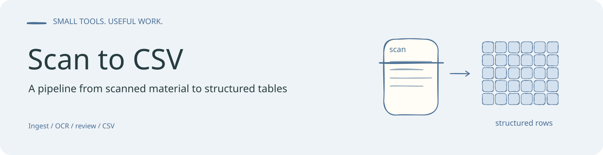
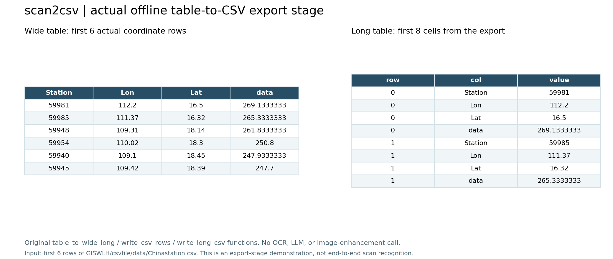

<!-- readme-visual-refresh:banner -->

<!-- /readme-visual-refresh:banner -->

# scan2csv

**任意扫描表格 → CSV** 桌面/本地服务工具。

```text
上传任意表
  → 多模态 Perceive（版式 + page_schema + 本页增强 prompt）
  → APIYI 增强
  → 本地 OCR
  → 多模态 Structure（装盒，单元格挂 ocr_ids 证据）
  → Review（改格 / 只重装盒 / 再增强）
  → CSV
```

- **LLM（Agent）**：OpenAI 兼容接口，UI / 环境变量配置 Base URL + API Key + 模型（推荐多模态，如 Grok）
- **图改图**：APIYI `gpt-image-2-vip`（`images/edits`）
- **OCR**：本地 PP-OCRv6（可选；未安装时自动降级为「Agent 直接读增强图」）

仓库：https://github.com/GISWLH/scan2csv

## 快速开始

```bash
cd scan2csv
python3 -m venv .venv
source .venv/bin/activate   # Windows: .venv\Scripts\activate
pip install -r requirements.txt

# 可选环境变量（也可在 Web 设置页填写并写入 jobs 旁的 settings）
export SCAN2CSV_LLM_BASE_URL="http://127.0.0.1:8015/v1"
export SCAN2CSV_LLM_API_KEY="sk-..."
export SCAN2CSV_LLM_MODEL="grok-4.5"
export APIYI_API_KEY="..."

python -m scan2csv serve --host 127.0.0.1 --port 8787
# 浏览器打开 http://127.0.0.1:8787
```

CLI 单页：

```bash
python -m scan2csv run path/to/table.png --out-dir ./out/job1
```

## Windows EXE

```powershell
pip install -r requirements.txt pyinstaller
powershell -File scripts\build_windows.ps1
# 产物: dist\scan2csv\scan2csv.exe
```

便携目录运行后会在用户目录创建工作区：`%USERPROFILE%\Documents\scan2csv\jobs`。

## 配置

| 变量 | 含义 |
|------|------|
| `SCAN2CSV_LLM_BASE_URL` | OpenAI 兼容 `/v1` |
| `SCAN2CSV_LLM_API_KEY` | Bearer Key |
| `SCAN2CSV_LLM_MODEL` | 如 `grok-4.5` |
| `APIYI_API_KEY` | 图改图 |
| `APIYI_IMAGES_EDITS_URL` | 默认 `https://api.apiyi.com/v1/images/edits` |
| `APIYI_IMAGE_MODEL` | 默认 `gpt-image-2-vip` |
| `APIYI_IMAGE_SIZE` | 默认 `3840x2160` |
| `SCAN2CSV_SKIP_ENHANCE` | `1` 时跳过 APIYI（调试） |
| `SCAN2CSV_SKIP_LLM` | `1` 时跳过 Agent（仅 OCR/启发式） |

## 目录结构

```text
scan2csv/
  scan2csv/           # Python 包
    pipeline/         # ingest → perceive → enhance → ocr → structure → review → export
    providers/        # llm / apiyi / ocr
    web/              # 静态前端
  scripts/            # 打包
  docs/
  requirements.txt
  pyproject.toml
```

## 许可

MIT

<!-- readme-visual-refresh:artwork-source -->
[Editable banner artwork · Excalidraw](assets/readme/banner.excalidraw)
<!-- /readme-visual-refresh:artwork-source -->


<!-- readme-visual-refresh:execution -->
## Demonstration captured on EHPC · 17 October 2026



Original CSV export function executed on a small explicit demonstration table. This validates the export step only; no OCR or full PDF-to-CSV pipeline was run.

[Execution record and checksums](assets/readme/execution-record.json).
<!-- /readme-visual-refresh:execution -->
